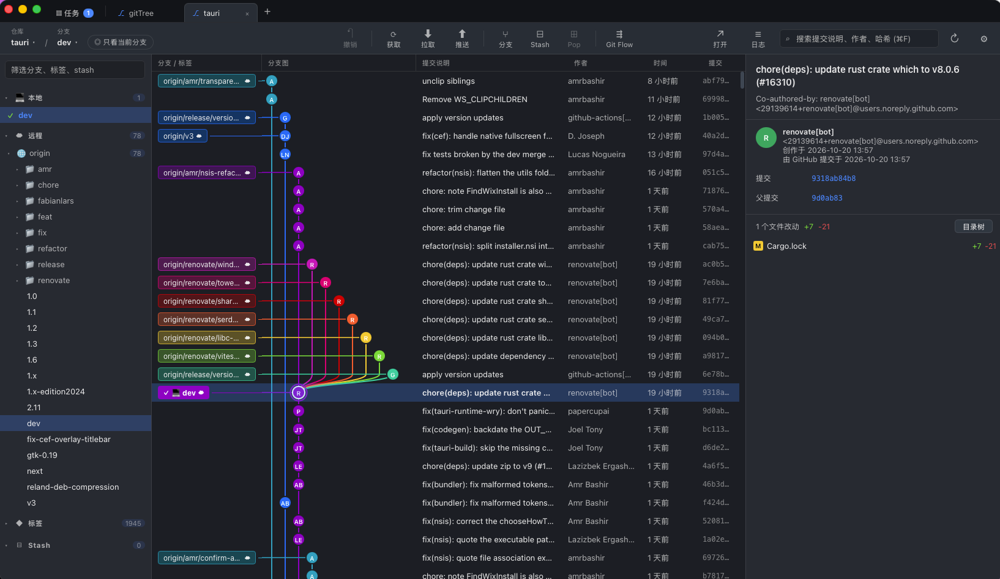

<div align="center">

# GitTree

**免费、开源、高性能的 Git 桌面客户端，支持 macOS 和 Windows。**

基于 Rust 和 Tauri 构建。几十万个提交、上千个分支的仓库也能保持流畅。

[](https://github.com/ADroidCoder/GItTree/actions/workflows/build.yml)
[](https://github.com/ADroidCoder/GItTree/releases/latest)
[](LICENSE)


[English](README.md) · 简体中文

[**下载**](https://github.com/ADroidCoder/GItTree/releases/latest) · [功能](#功能) · [性能](#性能) · [从源码构建](#从源码构建)

</div>

<p align="center"></p>

---

## 为什么选择 GitTree

很多 Git 图形客户端会随着仓库变大越来越卡：打开要等好几秒，滚动掉帧，分支列表卡住。GitTree 的设计目标正好相反：**不管仓库多大，每一次操作都要立刻响应。**

- **为速度而设计**：历史从 Git 的 commit-graph 索引读取，分支图布局 O(n) 一次算完，所有列表都虚拟化渲染。打开 Git 官方仓库（8.5 万提交、1000+ 引用）约 120 毫秒。
- **原生、轻量**：使用系统自带的 WebView，不打包 Chromium，安装包只有几 MB。
- **行为和命令行完全一致**：所有修改操作都交给系统安装的 `git` 执行，hooks、GPG 签名、SSH 密钥、凭据管理器都和终端里一样。
- **免费开源**：Apache 2.0 协议，不需要注册账号，没有数据收集，没有付费版。

## 下载

在 [**Releases 页面**](https://github.com/ADroidCoder/GItTree/releases/latest) 下载最新安装包。

| 平台 | 文件 |
|---|---|
| macOS（Apple 芯片） | `GitTree_<版本>_aarch64.dmg` |
| macOS（Intel） | `GitTree_<版本>_x64.dmg` |
| Windows 10 / 11（x64） | `GitTree_<版本>_x64-setup.exe` 或 `GitTree_<版本>_x64_en-US.msi` |

**前提：** 需要安装 [Git](https://git-scm.com/downloads)，并且能在命令行里直接运行 `git`。

> [!NOTE]
> 安装包暂时没有代码签名。
> - **macOS**：如果提示“已损坏”或“无法打开”，在终端运行一次 `xattr -cr /Applications/GitTree.app`，或者右键点应用选择“打开”。
> - **Windows**：如果出现 SmartScreen 提示，点“更多信息 → 仍要运行”。

## 功能

### 历史和分支
- **提交图**：界面风格参考 GitKraken，默认深色主题，也可以用浅色或跟随系统。
- **多仓库标签页**：每个仓库一个标签页，下次启动自动恢复。
- **只看当前分支**：分支多的时候只显示当前分支，或者自选几个分支，图会清爽很多。筛选按仓库记住。
- **搜索**：按提交说明、作者或提交号搜索。
- **拖拽合并 / 变基**：把一个分支拖到另一个分支上，选择合并还是变基。

### 日常操作
- 按文件、按代码块或**按行**暂存、取消暂存、丢弃；提交、修改上一次提交。
- **diff 语法高亮和行内差异**：改动的行里具体哪几个字变了，会单独标出来。
- **对比任意两个分支、标签或提交**：可以像 GitHub 一样只看相对共同祖先新增的改动，也可以直接对比两端，同时列出中间的提交。
- 获取、拉取、推送时**实时显示进度和已用时间，可以中途取消**。执行过的每条 git 命令及其完整输出都能在日志面板里看到。
- **在客户端里登录**：git 需要用户名、密码、Personal Access Token 或 SSH 密钥密码时弹窗输入，由系统凭据管理器（macOS 钥匙串 / Windows 凭据管理器）记住。
- **后台自动获取**：默认每 10 分钟一次，可以修改间隔或关闭。
- **Stash**：查看 stash 里的文件和 diff（包括未跟踪的新文件），只 stash 选中的文件，应用 / 恢复 / 删除。
- 右键菜单里完成分支、标签、合并、变基、拣选、还原、重置。可以重命名分支（可选同时改远程分支），推送和删除远程标签，用 `--force-with-lease` 安全地强制推送。
- **远程仓库**：添加、重命名、删除、修改地址；一键复制仓库地址（会去掉地址里的密码 / token），或在浏览器里打开仓库网页。
- **有未提交的改动也能切换分支、拉取**：会提示先 stash，完成后再把改动恢复回来。
- **图片差异**：改了图片时并排显示新旧两张，或者拖动滑块对比，显示尺寸和大小。
- **加入 .gitignore**：右键未跟踪的文件，忽略这个文件、这类扩展名或整个文件夹。
- **克隆**（带进度）或**新建**仓库。
- **用外部程序打开**：编辑器（默认 VS Code，也支持 Cursor、IntelliJ IDEA 等）、终端、访达 / 资源管理器。

### 进阶工具
- **撤销**（⌘Z / Ctrl+Z）：撤销提交、切换分支、新建 / 删除分支和标签、合并、变基、拣选、重置、拉取、Git Flow 操作，最多 50 步。如果之后在别处改过仓库，会拒绝撤销，不会覆盖新的改动。
- **冲突解决**：每一处冲突左右对比“当前”和“传入”，选择用哪边、两边都要、用修改前的版本，或者手动编辑。GBK 等非 UTF-8 文件按原字节保留，不会被改坏。
- **交互式变基**：不需要命令行编辑器。拖动调整提交顺序，合并或删除提交，直接修改提交说明。
- **文件历史**（跟踪重命名）和 **Blame**（每一行的作者、时间和提交）。
- **Git Flow**：在一个面板里开始和完成 feature / bugfix / release / hotfix 分支，和 `git flow` 命令行、SourceTree 共用配置。
- **找回丢失的提交（Reflog）**：reset 过头、误删分支、变基后找不到的提交，都能在 HEAD 的移动记录里找到，右键从它新建分支就找回来了。
- **Pull Request / Merge Request**：支持 GitHub、GitLab（包括公司自己部署的）、Gitee、Gitea。在客户端里查看打开中的 PR，一键检出到本地或对比；从分支直接打开创建 PR 的网页。私有仓库需要填一次访问令牌，只保存在本机。
- **子模块**：侧栏列出子模块和状态（未下载、提交不一致），初始化、更新、更新到远程最新、同步地址，双击在新标签页打开。
- **工作树（worktree）**：把另一个分支检出到另一个文件夹，同时开发、编译，不用来回切换和 stash。
- **二分查错（bisect）**：标记一个好的提交和一个坏的提交，每一步告诉 GitTree 当前提交有没有问题，几步就能找到第一个引入 bug 的提交。
- **Git LFS**：图片等大文件正常显示差异；拉取 LFS 文件，右键把一类文件交给 LFS 管理。仓库用了 LFS 但没安装时会提醒。
- **提交签名**：提交详情里显示 GPG / SSH 签名是否验证通过。
- **多个提交身份**：公司和个人的用户名、邮箱各存一套，按文件夹自动切换（用的是 git 自带的 includeIf，命令行里也生效）；提交框上方总能看到这次会用哪个身份提交。

### 应用
- **命令面板**（⌘K / Ctrl+K）：输入几个字就能执行任何命令、切换分支、检出远程分支、跳到标签或打开仓库，支持拼音首字母。
- **提醒与通知**：在工作时间内定时提醒，比如“每小时喝水”“每两小时起来活动”；每天提醒到期和逾期的任务；推送、拉取、克隆等耗时操作完成或当前分支在远程有新提交时发通知。可以选择关闭窗口后留在菜单栏 / 托盘里继续运行。
- **中英文界面**：默认跟随系统语言，可以在设置（⚙）里随时切换。
- **自动更新**：后台检查 GitHub Release，有新版本时一键安装。更新包带签名，安装前会校验。

### 任务面板
全局的看板（待办 / 进行中 / 待验证 / 已完成，列可以自定义），可以设负责人、优先级、截止日期和检查项，也可以关联仓库和分支。完成的任务按设定的天数自动归档，归档后仍然可以搜索和恢复。数据保存在本机，不会写进仓库。

## 快捷键

Windows 上把 ⌘ 换成 Ctrl。

| 快捷键 | 作用 |
|---|---|
| ⌘K / ⌘⇧P | 命令面板 |
| ⌘O / ⌘T | 在新标签页打开仓库 |
| ⌘1 ~ ⌘9 | 切换到第 N 个标签页 |
| ⌘F | 搜索提交（回车下一个，Shift+回车上一个） |
| ⌘R / F5 | 刷新 |
| ⌘Z | 撤销上一步操作（在输入框里时撤销文字） |
| ↑ ↓ / j k | 在提交之间移动 |
| ⌘Enter | 提交（在提交说明输入框里） |
| Esc | 关闭 diff |

## 性能

在 [git/git](https://github.com/git/git) 仓库（约 8.5 万提交、1000+ 引用）上实测：

| 场景 | 耗时 |
|---|---|
| 打开仓库（有 commit-graph） | ~120 ms |
| 打开仓库（没有 commit-graph） | ~520 ms |
| 图布局计算 | 3 ms |
| 读取一屏 60 行的提交说明 | 2 ms |
| 滚动时的区间查询 | ~1 µs |

实现方式：

- **优先读 commit-graph**：不用解压提交对象就能读出历史。没有这个文件时会在后台自动生成（和 `git gc` 生成的是同一个文件）。
- **按需加载**：先读屏幕上能看到的行的作者和说明，其余的在后台多线程补全。
- **O(n) 图布局**：按 256 行分块建索引，滚动时每次查询约 1 微秒。
- **全面虚拟化**：提交列表和 diff 只渲染可见的几十行，分支线用 Canvas 绘制；滚动条是自己实现的，不受浏览器元素高度上限限制，百万级提交也能顺畅滚动。

自己测：

```bash
cargo run --release -p gittree-core --example bench -- /你的仓库路径
```

## 从源码构建

**环境要求**

- [Rust](https://rustup.rs/) 1.85 或更新
- [Node.js](https://nodejs.org/) 20 或更新
- Git
- 仅 Windows：[WebView2](https://developer.microsoft.com/microsoft-edge/webview2/)（Windows 10/11 一般自带）和 Visual Studio C++ 生成工具

```bash
git clone https://github.com/ADroidCoder/GItTree.git
cd GItTree
npm install

npm run tauri dev                          # 开发模式运行
GITTREE_REPO=/你的仓库 npm run tauri dev     # 启动时直接打开某个仓库
npm run tauri build                        # 打包安装包
```

产物位置：

- macOS：`target/release/bundle/dmg/*.dmg` 和 `target/release/bundle/macos/GitTree.app`
- Windows：`target/release/bundle/msi/*.msi` 和 `target/release/bundle/nsis/*.exe`

**测试**

```bash
cargo test -p gittree-core   # 核心库测试
npm run check                # 前端类型检查
```

**发布**由 [GitHub Actions](.github/workflows/build.yml) 完成：每次推送都会打出所有平台的安装包（在这次运行的 Artifacts 里下载）；推送 `v0.2.0` 这样的标签时，还会自动发布一个 GitHub Release 并附上安装包。

## 目录结构

```
crates/gittree-core/   核心库（不依赖界面，可以单独测试）
  src/log.rs           读取提交历史、引用、领先 / 落后数
  src/graph.rs         分支图泳道布局
  src/diff.rs          提交详情、文件 diff、按代码块生成补丁
  src/ops.rs           调用系统 git 执行的所有修改操作
  src/flow.rs          Git Flow
  src/undo.rs          撤销
  src/conflict.rs      冲突解析与解决
  src/history.rs       文件历史、Blame
  src/rebase.rs        交互式变基
  src/reflog.rs        Reflog
  src/forge.rs         识别 GitHub / GitLab / Gitee / Gitea，PR 地址和接口
  src/submodule.rs     子模块
  src/worktree.rs      工作树
  src/bisect.rs        二分查错
  src/lfs.rs           Git LFS
  src/identity.rs      提交身份和按目录切换
src-tauri/             Tauri 桌面程序，把核心库暴露给界面
src/                   Svelte 5 界面
```

**技术栈：** Rust · [gitoxide](https://github.com/GitoxideLabs/gitoxide) · [libgit2](https://libgit2.org/) · [Tauri 2](https://tauri.app/) · [Svelte 5](https://svelte.dev/) · TypeScript

## 参与贡献

欢迎提 Issue 和 Pull Request。提交 PR 前请确认 `cargo test -p gittree-core` 和 `npm run check` 都能通过。

## 开源协议

本项目基于 [Apache License 2.0](LICENSE) 开源：可以免费用于个人和商业用途，可以修改和再发布；再发布时需要保留版权和协议声明，并注明修改过的地方。
